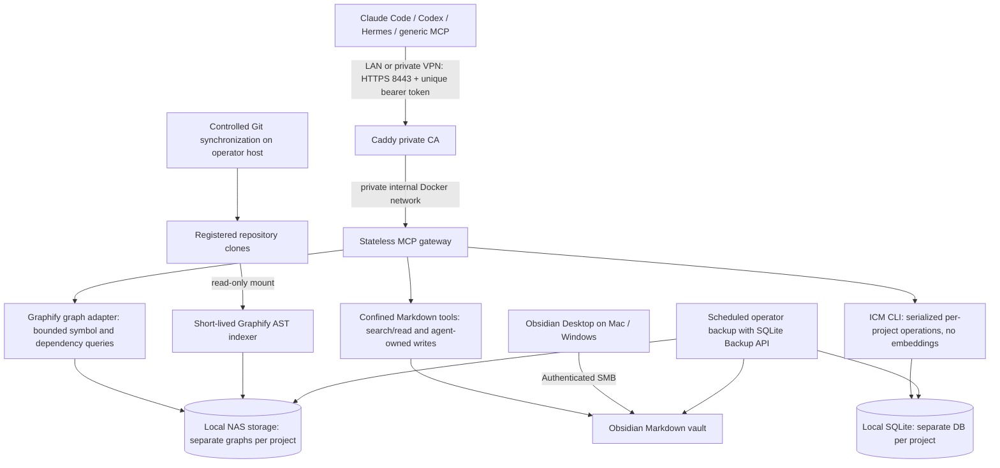

# Architecture

The native Graphify HTTP MCP implementation supports API-key authentication, but accepting arbitrary native project paths and exposing its full tool surface would not establish this deployment's project boundary. This adapter exposes a restricted traversal surface over verified Graphify artifacts. It preserves node/edge provenance; it does not reproduce Graphify's full natural-language ranking, semantic extraction, graph-write, or community tools.

ICM supports native stdio MCP and HTTP in feature-enabled builds. This build intentionally uses its CLI with only the SQLite feature. The gateway translates memory tools into verified CLI arguments, so no ICM HTTP route or MCP compatibility is assumed. One process/worker owns all access; the per-project reentrant lock covers recalls as well as writes because recall may update metadata. Backup uses a read-only connection and SQLite's backup API.

The stateless gateway adds no permanent memory store. Files contain knowledge, Graphify contains code relationships, and ICM contains durable verified memories. The only always-running services are gateway and TLS. The internal Docker network blocks general runtime egress; indexing jobs have no network. Git synchronization occurs outside the serving containers under the operator's control.

Runtime limits are configured ceilings, not measured usage: gateway 768 MiB/1 CPU, Caddy 128 MiB/0.5 CPU, indexer 2 GiB/2 CPU. Rust compilation can require more. ARM64 and Linux AMD64 are targeted by source builds but require build/runtime validation on the target architecture.
